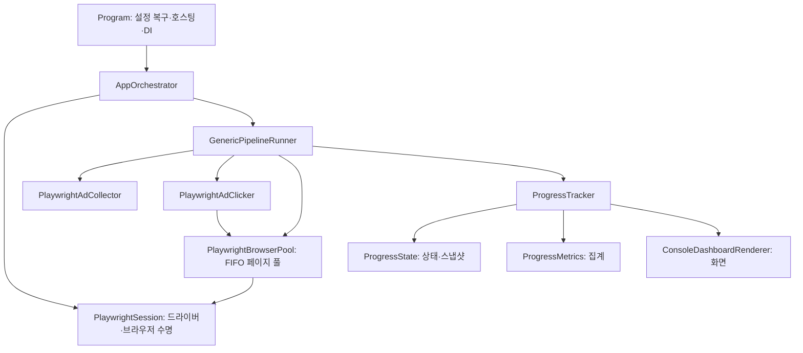

# InvenAdClicker

인벤 광고 클릭 자동화를 위한 콘솔 프로그램입니다.

본 프로젝트는 브라우저 자동화 학습을 위해 작성되었으며, 인벤 서버에 대한 악의적 트래픽을 발생시키기 위함이 아닙니다.

본 프로그램을 과도하게 사용하여 발생하는 문제에 대하여 작성자는 어떠한 책임도 지지 않습니다.

## 주요 기능

- **자동 로그인·보안 저장**: 최초 1회 입력한 계정 정보를 암호화해 다음 실행부터 자동 로그인합니다.
- **광고 큐 기반 자동 클릭**: 수집된 광고 링크를 큐로 관리해 다음 클릭을 지연 없이 실행합니다.
- **네트워크 부하 최소화**: 불필요한 리소스를 최대한 로드하지 않도록 차단/비활성화하여 실행 속도를 높입니다.
- **디버깅 옵션**: `Debug.Headless`, `Debug.JavaScriptEnabled` 값으로 브라우저 창과 JavaScript 실행 여부를 제어할 수 있습니다.
- **실시간 진행 상황**: URL별 수집·클릭 현황을 콘솔에서 즉시 확인할 수 있습니다.

## 구조



실행 단위의 DI 범위가 세션·페이지 풀·수집기·클릭기·파이프라인을 관리하며 종료 시 비동기로 해제합니다. 로그인 타임아웃과 클릭 실패는 공통 `AsyncRetry` 정책으로 재시도합니다. 대기 시간은 지수적으로 증가하며 최대 30초로 제한되고, 취소 요청은 재시도하지 않습니다.

## 사용법

### 1. 사전 준비

- Windows x64에서 실행합니다. 기본 Release 배포는 .NET 런타임을 포함합니다.
- 브라우저는 패키지 버전에 맞는 Playwright Chromium을 사용합니다. Chrome이나 Node.js를 별도로 설치할 필요가 없습니다.
- 최초 브라우저 설치에는 인터넷 연결과 브라우저 저장 위치에 대한 쓰기 권한이 필요합니다. 프로그램이 자동 설치한 뒤 재시작을 안내합니다. 직접 설치하려면 배포 폴더에서 실행합니다.

```powershell
powershell -NoProfile -ExecutionPolicy Bypass -File .\playwright.ps1 install chromium
```

### 2. 설정 (`appsettings.json`)

프로그램 시작 시 `%LOCALAPPDATA%\InvenAdClicker\appsettings.json`의 `AppSettings` 스키마를 자동으로 동기화합니다. 배포 폴더의 `appsettings.json`은 초기 설정 템플릿입니다.

별도 데이터 폴더를 사용하려면 `InvenAdClicker.exe --data-directory "E:\InvenData"`로 실행합니다. 해당 폴더에 설정·자격 증명·로그를 저장합니다.

- 새 설정이 추가되면: 기존 값은 유지한 채 누락된 필드를 기본값으로 추가
- 설정이 제거되면: 더 이상 사용되지 않는 필드를 제거
- 중첩 설정(`Debug`)도 동일하게 동기화

기본 설정 예시는 다음과 같습니다.

```json
{
  "AppSettings": {
    "MaxDegreeOfParallelism": 3,
    "DryRun": false,
    "IframeTimeoutMilliseconds": 5000,
    "ClickDelayMilliseconds": 300,
    "PageLoadTimeoutMilliseconds": 5000,
    "CommandTimeoutMilliseconds": 5000,
    "PostMessageBufferMilliseconds": 1000,
    "CollectionAttempts": 1,
    "MaxClickAttempts": 2,
    "Debug": {
      "Enabled": false,
      "Headless": true,
      "JavaScriptEnabled": true,
      "AllowImages": false,
      "AllowStylesheets": false,
      "AllowFonts": false
    },
    "TargetUrls": [
      "https://www.inven.co.kr/",
      "https://m.inven.co.kr/",
      "https://it.inven.co.kr/"
    ]
  }
}
```

| 설정 | 기본값 | 의미·검증 |
|---|---|---|
| `MaxDegreeOfParallelism` | `3` | 동시 페이지 수, 런타임에서 1~10으로 보정 |
| `DryRun` | `false` | 클릭을 시뮬레이션. 로그인과 수집 요청은 수행 |
| `ClickDelayMilliseconds` | `300` | 클릭 사이 대기. 200ms 미만은 실행 중단 |
| `PageLoadTimeoutMilliseconds` | `5000` | 탐색 타임아웃, 최소 1000ms |
| `CommandTimeoutMilliseconds` | `5000` | 명령 타임아웃, 최소 1000ms |
| `IframeTimeoutMilliseconds` | `5000` | iframe 대기, 최소 100ms |
| `PostMessageBufferMilliseconds` | `1000` | 메시지 수집 추가 대기, 최소 200ms |
| `CollectionAttempts` | `1` | URL당 새 탐색으로 수집하는 횟수, 최소 1회 |
| `MaxClickAttempts` | `2` | 링크당 클릭 시도 상한, 최소 1회 |
| `TargetUrls` | 예시 참고 | HTTP/HTTPS URL만 사용하며 공백·중복·잘못된 URL 제외 |

클릭 간격을 제외한 최소값 위반은 런타임에서 보정하고 사용자 파일의 값은 유지합니다. `CommandTimeoutMilliSeconds`, `IframeTimeoutMilliSeconds` 등 대소문자만 다른 구형 키는 기존 값을 유지하며 표준 이름으로 저장합니다. 손상된 JSON은 `.bak.<시간>` 파일로 백업한 뒤 기본 스키마로 복구합니다. 설정 파일을 읽거나 저장하지 못하면 경로와 원인을 보고합니다.

#### 디버그 옵션

- `Debug.Enabled`: `true`면 디버그 옵션을 활성화합니다.
- `Debug.Headless`: `false`면 실제 브라우저 창을 띄웁니다.
- `Debug.JavaScriptEnabled`: JavaScript 실행 여부를 제어합니다.
- `Debug.AllowImages` / `Debug.AllowStylesheets` / `Debug.AllowFonts`: 리소스 차단 해제(디버깅 용도)입니다.

#### 진행 상황 UI

표의 `Iter`는 해당 URL에서 **광고 링크 수집을 시도한 횟수**(= `CollectionAttempts` 누적)를 의미합니다.

### 3. 빌드 및 배포

실행 파일은 단일 파일로 배포하며, Playwright .NET 라이브러리와 드라이버 자산은 `playwright.ps1` 및 실행 시 찾을 수 있도록 별도 파일로 둡니다:

```shell
dotnet publish InvenAdClicker.csproj -c Release -o ./publish
```

출력 폴더(`publish`)에는 `InvenAdClicker.exe`, `Microsoft.Playwright.dll`, `.playwright` 런타임 폴더, 설정 파일(`appsettings.json`), 런타임 스크립트(`playwright.ps1`)가 생성됩니다. 배포 시 `.playwright` 폴더 전체를 포함하고, 모든 파일을 같은 폴더 구조로 유지하세요.

publish는 `PublishSelfContained=true`로 .NET 런타임을 포함합니다. 일반 build와 단위 테스트는 런타임을 포함하지 않습니다. Playwright DLL과 Node 드라이버는 디스크상의 경로로 접근하므로 실행 파일 안에 넣지 않습니다. 사용자 설정과 자격 증명은 아래 사용자 데이터 폴더에 저장됩니다.

### 4. 실행

`InvenAdClicker.exe`를 실행합니다.

- **최초 실행 시**: 콘솔 창에 인벤 ID와 비밀번호를 입력하라는 메시지가 나타납니다. 입력한 정보는 PC에 암호화되어 안전하게 저장되며, 다음 실행부터는 자동으로 로그인됩니다.

#### 사용자 데이터와 기존 파일 이전

| 파일 | 위치 |
|---|---|
| 사용자 설정 | `%LOCALAPPDATA%\InvenAdClicker\appsettings.json` |
| DPAPI 자격 증명 | `%LOCALAPPDATA%\InvenAdClicker\credentials.dat` |
| 새 실행 로그 | `%LOCALAPPDATA%\InvenAdClicker\logs\` |

새 위치에 파일이 있으면 그 파일을 사용합니다. 없으면 실행 파일 옆의 기존 파일을 우선 복사하고, 거기에도 없으면 실행 작업 디렉터리를 확인합니다. 후보가 여럿이면 우선순위와 충돌을 로그에 기록합니다. 원본은 남기고 기존 대상은 덮어쓰지 않습니다. 자격 증명은 현재 Windows 사용자에게 암호화된 바이트 그대로 복사하며, 이전 로그는 이동하거나 병합하지 않습니다.

풀 초기화에서 한 번 로그인·검증한 뒤, 인증된 브라우저 상태를 메모리로 작업자에게 전달합니다. 각 수집 시도는 새 탐색과 설정된 대기 버퍼를 사용하며, 다음 탐색 직전의 불필요한 새로고침은 생략합니다. 세션 전달을 위해 새 `inven_auth_*.json`을 임시 폴더에 만들지 않습니다.

### 5. 종료

- 종료 시 수집과 클릭의 성공·실패·미처리 수를 각각 표시합니다. 광고 없음은 정상이며 DryRun은 시뮬레이션 수로 구분합니다. 클릭 성공은 탐색 명령의 성공을 뜻하며 서버 측 보상 지급을 검증한 값은 아닙니다.
- `Ctrl + C`를 누르면 생산자와 워커에 취소를 전달하고 작업과 자원을 정리합니다. 응답하지 않는 브라우저 작업은 중단하며 종료 시간 초과와 정리 실패를 별도로 보고합니다.
- 대화형 실행에서는 결과를 확인한 뒤 키를 눌러 종료합니다.

| 종료 코드 | 의미 |
|---|---|
| `0` | 성공·정상 광고 없음 또는 브라우저 설치 완료 후 재시작 필요 |
| `1` | 사용자 취소 또는 설정 검증 실패. 화면과 로그에서 구분 |
| `2` | 초기화·치명적 실행·자원 정리 실패 또는 종료 시간 초과 |
| `3` | 일부 수집 또는 클릭 실패 |
| `4` | 수집 전체 실패 또는 클릭 대상이 있으나 클릭 전체 실패 |

종료 시간 초과가 표시되면 로그의 최초 오류와 정리 오류를 함께 확인하세요. 작업이 성공했다고 간주하거나 실행 중인 배포 파일을 바로 덮어쓰지 마세요.

## 로컬 개발과 검증

.NET 8 이상 SDK와 Windows x64 환경에서 저장소 루트 기준으로 실행합니다.

```powershell
dotnet restore InvenAdClicker.sln
dotnet build InvenAdClicker.sln -c Release --no-restore
dotnet test tests/InvenAdClicker.Tests/InvenAdClicker.Tests.csproj -c Release --no-build --collect:"XPlat Code Coverage" --results-directory ./artifacts/test-results
pwsh ./scripts/summarize-coverage.ps1 -ResultsDirectory ./artifacts/test-results
dotnet publish InvenAdClicker.csproj -c Release -o ./publish
pwsh ./scripts/verify-publish.ps1 -PublishDirectory ./publish -InstallChromium
```

`verify-publish.ps1`는 필수 배포 파일과 Playwright CLI를 확인하고, 해당 버전의 Chromium을 설치한 뒤 `InvenAdClicker.exe --smoke-test`를 실행합니다. 브라우저가 이미 설치됐다면 `-InstallChromium`을 생략할 수 있습니다. 스모크 테스트는 배포 템플릿과 격리된 데이터 경로에서 설정·DI·드라이버·브라우저를 검증하고 `about:blank`에서 JavaScript 계산을 수행합니다. 실제 사용자 파일 이전이나 계정 입력, 인벤 접속 없이 종료 코드 0이면 성공입니다.

CI는 테스트 결과·커버리지 요약·배포물을 보관합니다. 태그 릴리스는 스모크 테스트를 통과한 배포 폴더 전체를 ZIP으로 묶고 ZIP의 SHA256을 `checksums.txt`에 첨부합니다. `docs/`와 그 하위 계획 문서는 Git 추적 대상에서 제외합니다.

Chromium 통합 시험은 브라우저 설치 후 `INVEN_TEST_CHROMIUM=1`로 활성화합니다. 저장된 계정으로 실제 인벤을 확인하는 시험은 `INVEN_LIVE_DATA_DIRECTORY`를 지정한 경우에만 실행하며, 격리된 설정 복사본과 DryRun을 사용합니다.

## 트러블슈팅

| 증상 | 확인·조치 |
|---|---|
| `Microsoft.Playwright.dll` 또는 `node.exe` 누락 | 실행 파일만 복사하지 말고 `.playwright`를 포함한 배포 폴더 전체를 다시 복사합니다. |
| `Playwright 자동 설치 실패` | 화면과 로그의 PowerShell 종료 코드·stdout·stderr를 확인합니다. 배포 폴더에서 위 수동 설치 명령을 실행해 네트워크·쓰기 권한 오류를 확인합니다. |
| `Executable doesn't exist` | 배포된 `playwright.ps1 install chromium`을 실행합니다. 다른 버전의 npm Playwright 브라우저로 대신하지 않습니다. |
| 설정 검증 실패 | 메시지에 표시된 항목을 수정합니다. 특히 클릭 대기는 200ms 이상이어야 합니다. |
| JSON 손상 후 설정이 초기화됨 | 사용자 데이터 폴더의 `.bak.<시간>` 백업을 확인하고 올바른 JSON으로 필요한 값을 복원합니다. |
| 업데이트 시 실행 파일을 덮어쓸 수 없음 | 실행 중인 프로그램을 종료한 뒤 배포 파일을 교체합니다. |
| 브라우저 페이지가 종료됨 | 풀은 닫힌 페이지를 폐기하고 새 페이지로 보충합니다. 브라우저 연결 종료는 재시작 경로로 복구합니다. 반복되면 사용자 데이터 폴더의 `logs/`를 확인합니다. |

## 주의 사항

과도한 자동화 트래픽은 비정상적인 활동(DoS 등)으로 간주될 수 있습니다. `ClickDelayMilliseconds` 와 `MaxDegreeOfParallelism` 설정을 적절히 조절하여 단기간에 과도한 트래픽을 일으키지 않게 해야 합니다.

## 라이선스

본 프로젝트는 MIT 라이선스 하에 배포됩니다. 자세한 내용은 `LICENSE` 파일을 참고하세요.
